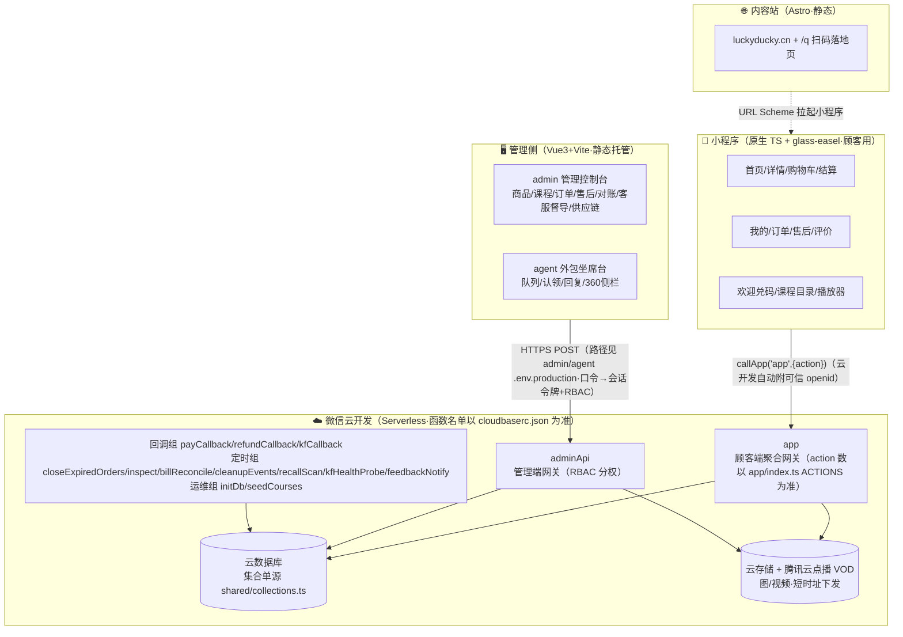
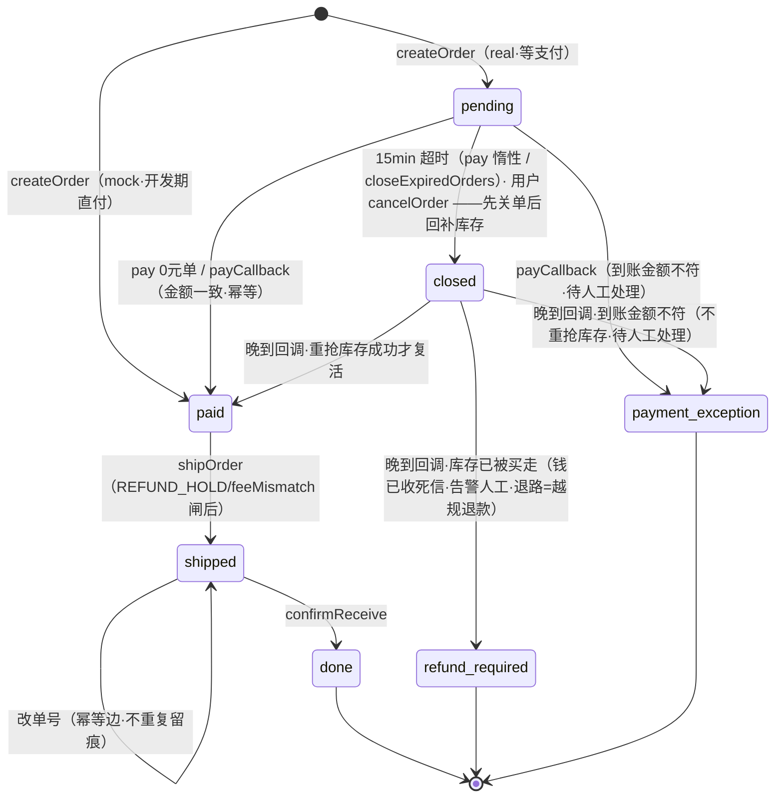

# 业务逻辑架构与主要逻辑链

> 系统怎么跑起来：三层架构、数据存哪、每条业务链的触发→步骤→闸门→状态变化。代码按技术分层组织，本文按业务链把分布在多个文件里的逻辑汇成一处（决策§17）。
> 错误码全表、计数、接口清单以代码为准，不在此复抄；状态机改动先改 `rewrite/shared` 的声明表。图用 Mermaid。

---

## 一、系统架构总览（三层）

**两条进云的通道（鉴权模型）**

- **顾客端 → `app` 聚合网关**：mp 一律 `pages → lib → api → utils/cloud.ts callApp()`（依赖方向单向·禁裸 wx.request）→ `wx.cloud.callFunction({name:'app',{action}})`，显式超时。客户端**永远不传身份**：云端 `kit/gate.ts withOpenId()` 从 `getWXContext()` 取可信 OPENID，无则拒 `NO_OPENID`；未知 action fail-closed 拒。每个写类 action 自带频控 `withRateLimit`。
- **管理端 → `adminApi`（HTTP 路径以 `rewrite/admin/.env.production` 的 `VITE_ADMIN_API`、`rewrite/agent/.env.production` 的 `VITE_AGENT_API` 为准）**：仅 POST；认证频控（per-IP 失败超限即锁；全局爆破只发 `GLOBAL_BRUTE` 告警不预拒，防轮换 IP 锁死真超管）→ 口令校验 **salt+scrypt KDF**（存量 sha 账号登录后就地升级）→ 登录签发 **sessionToken**（sha256 入库·有 TTL 与单号会话上限·前端只存令牌）；另有企微 OAuth 免登 `loginByWecomCode`。→ **RBAC 能力闸** `ACTION_CAPS`：未登记 action 默认 `admin:write`（仅超管）；外包角色只有 `agent:handle`；退款专员面走 `refund:manage`（只读加载面任一命中数组·无过滤翻单强制精确单号）。写类 action 自动审计 `recordAudit`；「读他人全貌」类破例留痕。
- **回调/定时函数**：`isServerCall()` 防伪——**带 OPENID 即视为客户端伪造**（静默 ACK + `FORGED_CALLBACK` 告警，不给探测信号）；定时器拒客户端直调（`SERVER_ONLY`）。

**数据面三条铁律**：① 集合单源 `rewrite/shared/src/collections.ts` 的 `COLLECTIONS`（个数以该表为准，每个集合须在 `console-assets/02-库权限期望表.md` 登记）；② **写库必过闸**——函数单元出现写库必须有 withOpenId/checkKey/defineNotifyCallback 等闸之一；③ 受保护内容 fileID 只在服务端，鉴权后换**短时地址**下发（`kit/storage.ts`/`kit/vod.ts` 单点收口）。

---

## 二、主要业务逻辑链

> 每条：**触发 → 步骤 → 关键闸门 → 状态变化**。错误码只列关键项（全表在代码+测试）。

### 链 1 · 登录与身份
- **触发**：进小程序首个 tab 页弹登录半屏（软门槛·本会话至多一次·可「暂不登录」继续逛）；点「微信一键登录」才出网。
- **步骤**：`lib/loginGate.ts` 单例管半屏 → `login` action：`withOpenId` 取可信 OPENID → `users` upsert（**确定性 `_id`=OPENID** 幂等建档·老随机 id 惰性迁移）→ best-effort 存 unionid（供客服反查）。「登录」在产品语义上=用户勾协议同意，技术身份始终是静默 openid——全 mp 无 wx.login/token 概念；**零资料采集**（平台已废 getUserProfile），资料走 profile-edit 补录（白名单+msgSecCheck/imgSecCheck fail-closed·非法手机号不覆盖旧号）。退出登录只清本地 hint，服务端不动。
- **闸门**：NO_OPENID / RATE_LIMITED/ SEC_CHECK_FAIL。隐私授权闸 `privacyGate`（`wx.onNeedPrivacyAuthorization`）独立于登录、按需触发。

### 链 2 · 商品上架（草稿 → 发布 → 下架/恢复 → 删除）
- **触发**：店主在 admin 商品页/上新向导操作。
- **步骤**：`saveDraft`（白名单消毒+SCM 组合键出生点校验防 `__` 撞库存键）→ `publishProduct` 四道门（NEED_COVER/NEED_INFO/NEED_SKUS·重发布保留旧下架态不隐式复活）→ mp `getProducts` 只发在售（`listed≠false`·列表瘦身不下发 images）。软下架/恢复：`unpublishProduct`/`republishProduct`，停售商品下单被拒 `UNLISTED_ITEM`。`deleteDraft` 先删发布面再删草稿（失败可见+告警）。
- **图册孤儿 GC**：换图/发布替换/删除产生的旧图入 `pendingGc` 24h 缓期队列，`timers/cleanupEvents` 到期删（cover 永豁免·订单快照要用）。

### 链 3 · 课程内容与播放（制课 → VOD 转码 → 发布 → 鉴权播放）
- **步骤**：admin 传视频**双线**——课程线显式 opt-in 直传 VOD（自动转码·未配置 VOD 自动回退云存储老路零影响·帮助视频线恒走老路）→ `saveCourseDraft`（baseRev 乐观并发防双管理员互吃 DRAFT_CONFLICT）→ `syncVodMedia` 拉模式回写转码产物（vodUrl/poster/雪碧图）→ `publishCourse` **转码就绪发布闸**（VOD 段未就绪拒 VOD_PROCESSING·「传完≠可播」）→ 整份覆盖 `courses`（引用模型·老学员自动生效）+ 孤儿视频缓期 GC。
- **播放鉴权（服务端 fail-closed）**：mp 目录 `getCourses` 逐层白名单**绝不下发视频源**；`getPlaybackUrl` 须本人 `activations.enteredAt≠null` 否则 `NOT_ENTITLED`；VOD 地址带 Key 防盗链签名（playKey 未配**绝不裸发**）。mp 侧 playToken 只是切段防乱序回包的客户端令牌。

### 链 4 · 下单（购物车/立即购买 → createOrder → pay → 回调 → 关单）
- **步骤**：mp 结算草稿（内存态不持久化·每稿一个幂等键）→ `createOrder`：行清洗 → **价格库内现算**（不信前端·UNKNOWN_SKU/停售拒）→ 金额全链**分整数**（Fen 品牌类型）→ 地址白名单 → 支付配置 fail-closed（mock 须环境变量显式放行 PAY_CONFIG_MISSING）→ 在途上限 MAX_PENDING_ORDERS=5 → **幂等 claim**（`orderIdempotency` 确定性 id·同次提交重试不建二单）→ **防超卖 reserveStock**（CAS 全有或全无 OUT_OF_STOCK）→ 落单（real=pending / mock=paid·条目含封面快照）。
- **支付**：`pay` 金额取库内、只收本人 pending、过 15 分钟窗惰性关单；`payCallback` 防伪+幂等，金额一致才 `pending→paid`，少付/多付进入 `payment_exception`（记录应付/实付/方向，**发货冻结**，待人工退款或补差；激活码随货交付——未发货即拿不到码，自然无法进课，兑课入口本身不校验订单状态，改线上发码前须补闸）；`timers/closeExpiredOrders` 兜底关单——**先关单后回补库存**（错向安全）。关单后晚到回调：金额一致且重抢库存成功 `closed→paid` 复活，库存不足进 `refund_required` 死信态（钱已收·告警人工退，退路=越规退款通道，见链 10），金额不符进 `payment_exception` 且不重抢库存。用户可 `cancelOrder`。
- **占位现状**：结算抵扣/运费常量以 `rewrite/shared/src/checkout.ts` 为准（主线已卸占位抵扣），另有 COUPON_EXCEEDS_GOODS 闸防「货款被抵到 0 白送」；真券系统未做（已定走微信支付商家券、只在测试版，见需求 R20 与 Issue #122）。

### 链 5 · 履约（发货 → 合规上报 → 确认收货）
- **步骤**：admin 单发/批量共用 `shipOne` 单源：状态闸（仅 paid 首发/shipped 改单号）→ `feeMismatch` 挡单（人工 `clearFeeMismatch` 解除）→ **退款↔履约同步闸**：现场读 afterSales，有在途/已退行拒 `REFUND_HOLD`（反向竞态对称告警 SHIP_REFUND_RACE）→ 条件更新翻 shipped + `shipUploadLock` 互斥（防与确认收货竞态·陈旧锁可抢占）→ 首次发货落 SCM `ship` 核销流水→ **微信发货信息合规上报** `uploadShippingInfo`（fail-soft 不回滚发货·失败告警）。
- **发货工作台 Fulfill**：拣货备货汇总（refundHold 单整单跳过）→ 打印内部标签（QR=订单 id·不带金额/openid）→ 扫码枪一框收两码安全判序（误扫拦截）。
- **确认收货**：mp 二次确认 → `confirmReceive` 本人+仅 shipped，`transition` 条件流转 shipped→done（防重复/并发）。

### 链 6 · 二维码激活（生码 → 扫码兑课 → 确认进课 → 退货权失效）
- **步骤**：admin `createBatch` → `generateQrcodes`（`adminApi/actions/batches.ts`·课程须存在·码空间 ≈1e15 无歧义字符表）→ 印刷包（卡面 SVG+地址 CSV·未配网址前缀挡导出）。顾客扫卡 → site `/q` 落地页 → URL Scheme 拉起 welcome 页自动兑码：`activateCourse` **一码一用条件抢占**（他人码 CODE_TAKEN·本人重扫幂等自愈·同用户并发双扫读回修正）→ `confirmEnter` 写 `enteredAt`（**进课唯一闸+退货权失效法律节点**·首次进课按「最早可退的本课程行」逐件失效 entVer CAS 防并发少记）→ `getMyCourses` 只认已进课。**码不绑订单**（决策§12 备货封码）。
- **闸门**：activateCourse/confirmEnter 频控（猜码爆破面）；激活记录持久化失败**不伪造成功**；confirmEnter 撤退货权 CAS 耗尽则**回滚本次进课**（不留「课已交付+钱仍可退」）。

### 链 7 · 学习进度（埋点 → 折叠 → 续播到秒）
- **步骤**：播放器 fire-and-forget 上报（失败不反噬播放）→ `trackEvent`：`events` 流水照记 + **防伪造闸**——segment_done/watch_at 须本人已进课才折叠进 `progress`（拒绝方式＝静默不折叠，不给攻击者信号）；`progress` 每人每课一条（done 段表+last 位置到秒）。`client_error`/`video_error` 类型兼任异常桥入 `anomalies` 账本。埋点面含电商漏斗+冷启动。
- **续播**：`continueResolve` 纯函数（段不可播逐级降级·秒归零防串段）+ `clampResumeAt` 单源 + initialTime/onVideoMeta 双保险 seek——「继续学习」到秒。

### 链 8 · 评价（done 单逐行写评 → 公开读）
- **步骤**：订单详情 done 态逐行「去评价」→ `submitReview`：本人+已完成+行在单内 → **一单一行一评**（确定性 `_id`=orderId__lineId·幂等预检刻意排在内容安全前防重复计费外呼）→ **UGC 双重内容安全 fail-closed**：文本 msgSecCheck + 晒图逐张 imgSecCheck→ 落库 `picked:false`（昵称云端快照·可匿名·**不自动上墙**）。admin「评价挑选」`setReviewPicked` 勾上架后才公开。
- **读侧**：`getReviews` / `getRatingSummary` 公开读只认 `picked:true`（缺字段/false 不出·fail-closed；字段裁剪不下发 openid/orderId/picked·晒图只发短时址）+ 精确评分汇总与列表同口径。详情页走 slim `getRatingSummary`（count=0 不渲染假评）。注意：首页「买家秀轨」是 CMS 内容（链 9），与真实评价墙两条数据源。

### 链 9 · 内容运营 CMS（五页文案 + 首页九板块 + 橱窗 + 帮助视频）
- **步骤**：admin「页面内容」五页签（welcome/catalogPlayer/mePage/about/agreement）+ 首页九板块 + 橱窗排序 + 帮助视频 → 云端**逐页白名单净化**入 `content` 集合（未知 page fail-closed·协议页服务端版本史 _v CAS·helpVideos rev 乐观并发+孤儿视频 GC）→ mp 经会话缓存+映射层消费，**整档缺失/逐字段空全部回退设计默认文案永不空屏**（welcome 不可退货告知不许清空）；首页另有冷启动快照 SWR。橱窗=改 `products.sort/featured`（逐条失败计数 PARTIAL_WRITE+告警）。

### 链 10 · 售后退款（申请 → 审批 → 工作流退款 → 回调）
- **步骤**：mp 可申请行前端预筛（与云端同口径）→ `applyRefund`：本人+状态闸+行 `refundable` 闸（进课即失·剩余件数）→ **金额云端分摊** `refundShareFen`（行/单双口径封顶 NOTHING_LEFT）→ **一单一行一售后**（确定性 `_id`；顾客撤销 `withdrawRefund` 后同行可重新申请，原子复用同一张单）。admin `approveRefund`：审批时刻**重算剩余可退**（申请后又进课降级 requalify）→ 经 `kit/flow.ts callFlow` 触发控制台退款工作流（平台接缝单点·工作流正册 `console-assets/01-支付退款工作流.md`）→ 未受理条件回滚 approved→applied。`refundCallback`：防伪+单号金额核验 fail-closed（不符不置 refunded·MISMATCH 告警）+ 幂等抢占；退款成功仅订单仍 paid 才回补库存（已发货不回补防幻影超卖）。
- **越规退款** `overrideRefund`（决策§26·cap `refund:manage`）：管理员越资格**不越钱**（钱守恒封顶）；`refund_required` 死信单仅此通道放行（closed 不放行=没收过钱）。

### 链 11 · 客服（bot 分流 → 自建坐席台 → 360/CSAT/质检）
- **步骤**：mp 四触点收口 `utils/customerService.ts` → 企微微信客服；每条顾客消息经 `kfCallback`（验签+AES+receiveId 三闸 fail-closed）→ 增量拉取（整批成功才推进游标·消息原子认领去重·失败不吞单重拉）→ `dispatch` 分流：FAQ 读 `kb` 集合单源 / 查订单（`kfIdentity` 身份桥零幻觉·未绑定引导登录）/ **转人工入自建 `csSession` 队列**（平台会话保持智能助手态、不转原生接待台——转过去坐席发送会报 95018）。
- **坐席台 `/agent`**：口令或企微免登 → 轮询队列/线程 → `claimConversation`（接待上限·escalated 仅超管）→ `sendAgentMessage`（仅 active·48h 窗口·失败不清输入框）→ 360 侧栏 `getSessionCustomer360` **双闸**（分配制 scope=只看自己接的 + 数据共享同意 `users.csDataShare`·强制审计留痕）→ 升级转商户/结束触发 CSAT（1-5 fail-closed）→ 会话归档 `conversations` → 质检抽样（CAS 防覆盖·超管专属）。
- **范围**：订单类咨询走微信客服（bot + 360 自动答），钩织学习求助引导加企微做私域；坐席在工作台看顾客的订单、物流、画像、学习位置、节点照片来精准指导。按需未做：企微侧栏 360（承面 A）、支付投诉/换货/跨 openid 合并等合规补全、AI 与直播教学。拍板见决策§19。

#### 客服 360 架构规范（五条铁律 + 信任边界）
360 由一组自包含的功能板块组成，每个板块对外只暴露一个声明式接口：
- **铁律一 模块为单位**：一个板块＝自己的 cloud actions + admin 组件/页 + 自己的集合；一个施工批次产出一个自包含板块。
- **铁律二 板块间解耦**：禁止直接 import 对方内部，协作只经统一接口或注册表。
- **铁律三 provider 模式**：`getCustomer360` 是编排器，本身不认识任何板块；每个面板实现 `CustomerPanelProvider { key, label, enabled, order, fetch(openid) }` 并登记到 `customer360/registry.ts`，编排器只遍历 enabled 的 provider。加/删/改面板只动那个 provider。
- **铁律四 可单独开关**：板块声明 `enabled`，关掉即不挂载、不进聚合、不暴露入口，便于灰度与单独止血。
- **铁律五 开放封闭**：新板块＝实现接口 + 登记 + 配开关，编排器/页面壳/路由零改动。
- **§1.5 信任边界**：360 是本项目第一个「非本人批量读他人全量数据」的口子（订单 + 物流 + 个人信息 + 学习轨迹），所以**审计（谁查了谁）与能力闸（谁有资格查）必须与数据暴露同时上线**。给第三方坐席/外包看数据时才触发告知同意义务，商户本人查看不触发。
- **防过度**：板块粒度是一个有意义的功能单元；provider 接口只在真有多个同类面板要聚合时用；开关只给会独立开关的板块。信任边界守卫不算过度，它守的是真实存在的越权面。

### 链 12 · 供应链 SCM（采购/外协/配方组装/备货/核销）
- **五门架构**：门1 `kit/scmStock.applyStockMoves`＝**全库唯一原料账房**（确定性流水 id 幂等+CAS 余额不为负）；门2 状态机声明表（`shared/scm.ts` 手改单源）；门3 `resolveBom` 纯函数配方解析；门4 `kit/inventory` 成品账（下单扣/关单退款回补/组装入）；门5 action 文件级车道隔离。
- **业务动线**：采购 received 入原料账 → 外协发 L 原团收同色带结团（收≤发防凭空入库·应付=收×单价定格）→ 组装按 **bomSnapshot 快照**扣料入成品（历史单不追新）→ 订单下单即扣防超卖 → 发货落 ship 核销流水 → 备货计算器（只读·缺口按供应商分列）。范围只做进销存最小闭环，**不做**财务凭证、多仓、批次效期（需求 R31）。

**需求定稿**：
- **物料与计量**：每个料号建档时锁死计量（件或克，一律正整数）。毛线＝颜色 × 量级（大/中/小三档克重）× 形态（原团/带结）按团记，**只有最大团有带结形态**；填充棉按克；外包装、卡片、钩针、记号扣、缝针、钥匙扣、玩偶眼睛按件。外包装与卡片随产品变，每个产品一个专属料号。
- **外协**：织女每人一档；发最大团原团（按色）→ 收同色同量级带结团入库 → 损耗＝发−收 → 应付＝收回数 × 计件单价 → 结算销账。
- **配方**：全局一张模板，每个产品三个填空（三个量级各选颜色 + 专属包装 + 专属卡片）；最大团用带结，中/小团用原团。组装单存模板快照，历史单不追新。
- **核销**：沿用「下单即扣成品库存」防超卖，钱链热路径不加写；发货时核对实发数并写流水留痕。
- 可选后置：卡片入库数 ↔ 该产品激活码池未用数对账。

**料号命名契约**（代码即真值 `rewrite/shared/src/scmKey.ts`）：毛线 `yarn:<color>:<L|M|S>:<raw|knotted>`（knotted 仅 L）；产品专属件 `pkg:<productId>` / `card:<productId>`；共用辅料用语义名（`stuffing` `hook` `marker` `needle` `keyring` `eyes`）。由建档程序生成，不手拼。

**对账公式**：原料侧 Σ流水 ⇄ `materials.stock`；成品侧 Σ(assembly_in / ship / adjust 流水) + 订单预留 ⇄ `inventory.stock`（下单预留刻意不写流水，订单本身就是那笔账的单据）。

### 链 13 · 观测与巡检（告警 → 账本 → 巡检/心跳 → 对账）
- **告警单出口**：动作失败一律 `kit/observe.notifyAlert`三段式——`[LD_ALERT]` 结构化日志 + 桥入 `anomalies` 异常账本（敏感键剥除·指纹聚合去重）+ 企微群机器人推送（`kit/botpush` 唯一接缝·webhook 未配则只前两头）。
- **巡检机**：`timers/inspect` 定时跑三查（db 可达/钱守恒/卡单+死信）写 `inspectRuns`，红项入账本；**每日心跳报平安**（确定性日 id·「该来的消息没来」本身成告警）。`timers/billReconcile` 每日拉微信账单逐笔对账（差异入账本告警）。客户端错误三端桥入（mp trackEvent 桥 / admin+agent errorReporter·会话去重封顶）。admin「体检/异常账本」两页消费（手动巡检/标记已处理）。

---

## 三、关键状态机（声明单源 `rewrite/shared`·`transition()`＝DB 层 CAS·一次性副作用绑首次转移）

### ① 订单（ORDER_STATUS_SPEC·`shared/src/order.ts`）

### ② 激活/进课
`qrcodes`：唯一边 `unused→activated`（一码一用条件抢占·同时写 activatedBy/At）。`activations.enteredAt`：null=已激活未进课 → 时间戳=已进课（**非 status 机·null→值条件抢占只翻一次**）——它是播放鉴权唯一钥匙 + 退货权失效法律节点。

### ③ 售后（AFTERSALE_STATUS_SPEC）
`applied→approved`（审批抢占·触发退款工作流）；`approved→applied`（工作流未受理条件回滚）；`applied→rejected`（必填原因）；`applied|approved→refunded`（回调幂等）；`applied→withdrawn`（顾客撤销·与审批抢同一个 applied，谁先到算谁的；批过又回滚的单不许撤）；`withdrawn→applied`（撤销后重新申请·复用同一 `_id` 与退款单号）。终态=refunded/rejected（withdrawn 不是终态、不占退款额度）；全表以 `rewrite/shared/src/order.ts` 为准。

### ④ 客服会话（CS_SESSION_STATUS_SPEC·**无终态**）
`pending→active`（认领·接待上限）；`active→pending`（放回队列）；`active→escalated`（升级商户·仅超管可再认领）；`pending|active|escalated→closed`（结束·触 CSAT）；**closed 可重开**（顾客再找人工·重开清质检标记）——画图勿把 closed 标终态。

### ⑤ SCM 两张（`shared/scm.ts` 手改单源）
采购 `draft→ordered→received`（received 首次流转绑入库幂等）+ `draft|ordered→cancelled`；外协 `draft→issued→delivered→settled` + `draft→cancelled`（issued 后异常走调整单·不做逆向流转）。

---

## 四、通用安全闸门（模式层·对应守卫 grep `scripts/check-structure.mjs`）

| 模式 | 机制 |
|---|---|
| 身份 | 顾客端可信 openid 云端自取；管理端 scrypt 口令→sessionToken→RBAC caps 默认拒 |
| 定价/金额 | 价格库内现算不信前端；金额全链分整数 Fen；退款分摊封顶钱守恒 |
| 回调防伪 | 见 OPENID 即拒（静默 ACK+告警不给探测信号）；单号金额核验 fail-closed |
| 并发/幂等 | `transition()` 声明表 CAS；确定性 `_id`（订单幂等 claim/流水/评价/售后） |
| 频控 | 登录与高频写端点必过 withRateLimit / adminApi 双层认证频控 |
| UGC | 评价文本/晒图、昵称/头像、诊断照片——内容安全 fail-closed；客服打字/意见反馈正文——msgSecCheck **fail-open**（违规仍拒，接口抖动放行并记日志） |
| 读边界 | 列表 cursor/limit 分页契约；受保护 fileID 不出口只发短时址 |
| 失败可观测 | 动作类失败禁静默吞·`observe.alert` 单出口 |
